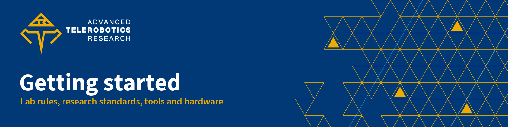

  

  <b>The onboarding handbook for new members of the Advanced Telerobotics Research Lab: research standards, paper templates, the lab's tech stack and hardware, and the rules we work by.</b> 
  Advanced Telerobotics Research Lab · Department of Computer Science · Kent State University

  
  
  

## Start here

<table>
  <tr>
    <td width="33%" valign="top">
       
      <b><a href="research/standards.md">Research standards</a></b> 
      Integrity, IRB and CITI training, authorship, data, reproducibility and AI disclosure.
    </td>
    <td width="33%" valign="top">
       
      <b><a href="research/writing-papers.md">Writing papers</a></b> 
      LaTeX for ACM and IEEE venues, a venue table and ready-to-compile templates.
    </td>
    <td width="33%" valign="top">
       
      <b><a href="tech-stack/README.md">Tech stack</a></b> 
      From drivers to AI coding agents: ROS 2, Isaac Sim, MuJoCo, Fusion, Docker and more.
    </td>
  </tr>
  <tr>
    <td width="33%" valign="top">
       
      <b><a href="lab-rules/README.md">Lab rules</a></b> 
      Code of conduct and everyday best practices for a shared lab.
    </td>
    <td width="33%" valign="top">
       
      <b><a href="lab-rules/safety.md">Safety</a></b> 
      Emergencies, soldering, robots in motion, batteries, resin and lasers.
    </td>
    <td width="33%" valign="top">
       
      <b><a href="hardware/README.md">Hardware</a></b> 
      The lab's robots, computers and printers: specs, setup and safety.
    </td>
  </tr>
</table>

## Welcome and your first week

The Advanced Telerobotics Research Lab at Kent State University is an innovation research laboratory focused on exploring the frontiers of telepresence robotics, tele-embodiment, autonomy and artificial intelligence. This handbook is what we wish every new member had on day one. Work through the checklist below in your first week; your mentor can help with any step.

**Accounts**

- [ ] Accept the invitation to the [ATR-Lab GitHub organization](https://github.com/ATR-Lab). Ask [who sends GitHub organization invitations] to invite your GitHub account, and turn on two-factor authentication first.
- [ ] Join [Slack workspace] and the [main lab channel].
- [ ] Subscribe to the lab calendar, [lab calendar].

**Trainings**

- [ ] Complete the lab safety orientation with [lab safety contact] before you use any tool, machine or robot.
- [ ] Complete CITI human-subjects training before you work on any study with people. Most human-robot interaction studies need it; see [human-subjects research](research/standards.md#human-subjects-research).

**Read**

- [ ] The [code of conduct](lab-rules/code-of-conduct.md) and the [safety rules](lab-rules/safety.md).
- [ ] The [best practices](lab-rules/best-practices.md): Slack, calendar invitations, equipment checkout and shared GPUs.

**Set up**

- [ ] Set up your machine with the lab's [dev guidelines](https://github.com/ATR-Lab/dev-guidelines) (Git, editors, formatters and linters).
- [ ] Install ROS 2 with [All things ROS 2](https://github.com/ATR-Lab/all-things-ros2), then skim the [tech stack](tech-stack/README.md) for the tools your project uses.

**Meet**

- [ ] Meet your mentor, [mentor name], and agree on a first task and how often you will meet.

## Repo map

| Path | What it holds | Read it when |
| --- | --- | --- |
| [`research/`](research/README.md) | Research standards, writing papers, the publishing checklist | You start a study, write a paper or prepare a submission |
| [`templates/latex/`](templates/latex/README.md) | Compilable IEEE and ACM paper skeletons with the lab's affiliation block | You start a new paper |
| [`tech-stack/`](tech-stack/README.md) | The lab's software stack by layer, one page per major tool | You set up a tool or pick one for a project |
| [`lab-rules/`](lab-rules/README.md) | Code of conduct, safety rules, best practices | Your first week, and whenever you are unsure what is allowed |
| [`hardware/`](hardware/README.md) | One page per robot, computer and printer: specs, setup, software, safety | Before you use a device |
| [`AGENTS.md`](AGENTS.md) | Instructions for coding agents: repo map, sources of truth, style, checks, open items | You edit this repo with Claude Code, Codex or another agent |

## Contributing

Found something wrong or out of date? [Open an issue](https://github.com/ATR-Lab/getting-started-atr-lab/issues) or send a pull request. Keep the style described in [AGENTS.md](AGENTS.md): sentence-case headings, Kent State editorial style, sources linked next to every technical fact and `[bracketed placeholders]` for anything only the lab can confirm. Run the checks listed there before you open a pull request.

## License

Text and code in this repository are released under the [MIT License](LICENSE). The names and logos of the Advanced Telerobotics Research Lab and Kent State University are trademarks and are not covered by that license.

The LaTeX templates load the IEEEtran and acmart document classes, which are distributed separately under their own licenses (LaTeX Project Public License); they are not part of this repository.

---

  <b>ATR Lab docs</b> ·
  <a href="https://github.com/ATR-Lab/about">About the lab</a> ·
  <a href="https://github.com/ATR-Lab/getting-started-atr-lab">Getting started</a> ·
  <a href="https://github.com/ATR-Lab/dev-guidelines">Dev guidelines</a> ·
  <a href="https://github.com/ATR-Lab/all-things-ros2">All things ROS 2</a> ·
  <a href="https://github.com/ATR-Lab">All repositories</a> 
  Advanced Telerobotics Research Lab · Department of Computer Science · Kent State University ·
  <a href="https://www.atr.cs.kent.edu/">www.atr.cs.kent.edu</a>

