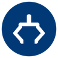

# Lab hardware

> **Read this when** you are about to use one of the lab's robots, computers or the resin printer for the first time, or you need its specs, software or safety rules.

This folder has one page per piece of lab hardware: what it is, what we use it for, verified specs, how to get started, which software and ROS 2 support it has, its safety rules and where to get help. Specs and procedures come from each manufacturer's official documentation, linked on every page. Anything only the lab can tell you (where a device lives, who owns it, how to check it out) is a `[bracketed placeholder]` until the lab fills it in.

> [!IMPORTANT]
> Do not power on any robot or the resin printer until you have been trained on it and finished the [checklist below](#before-you-use-any-hardware).

## Start here

<table>
  <tr>
    <td width="33%" valign="top">
       
      <b><a href="unitree-go2.md">Unitree Go2 Pro</a></b> 
      Quadruped robot: models, the app, community ROS 2 routes and fall safety.
    </td>
    <td width="33%" valign="top">
       
      <b><a href="booster-k1.md">Booster K1</a></b> 
      Humanoid robot: SDK, ROS 2 interface, training tools and fall safety.
    </td>
    <td width="33%" valign="top">
       
      <b><a href="openmanipulator-x.md">OpenManipulator-X</a></b> 
      ROBOTIS DYNAMIXEL arm: U2D2 setup, ROS 2, MoveIt 2 and simulation.
    </td>
  </tr>
  <tr>
    <td width="33%" valign="top">
       
      <b><a href="lerobot-so-101.md">SO-101 arms</a></b> 
      Leader and follower arms for LeRobot: calibration, teleoperation, datasets.
    </td>
    <td width="33%" valign="top">
       
      <b><a href="jetson-agx-thor.md">Jetson AGX Thor</a></b> 
      NVIDIA robot computer: JetPack, power modes, containers and Isaac ROS.
    </td>
    <td width="33%" valign="top">
       
      <b><a href="raspberry-pi-5.md">Raspberry Pi 5</a></b> 
      Small Linux computer: power, cooling, OS choice for ROS 2 and storage.
    </td>
  </tr>
  <tr>
    <td width="33%" valign="top">
       
      <b><a href="rosmaster-x3.md">ROSMASTER X3</a></b> 
      Yahboom mecanum-wheel mobile robot: controller, sensors and ROS 2 images.
    </td>
    <td width="33%" valign="top">
       
      <b><a href="formlabs-form-3.md">Formlabs Form 3</a></b> 
      Resin 3D printer: PreForm, washing and curing, resin safety and upkeep.
    </td>
    <td width="33%" valign="top">
       
      <b><a href="#before-you-use-any-hardware">Before you use any hardware</a></b> 
      Training, safety rules, checkout and credentials: do these first.
    </td>
  </tr>
</table>

## Inventory

| Device | Type | What the lab uses it for | Compute and SDK | [ROS 2 support](https://github.com/ATR-Lab/all-things-ros2/blob/main/docs/08-lab-robots.md) | Safety level | Page |
| --- | --- | --- | --- | --- | --- | --- |
| Unitree Go2 Pro | Quadruped robot | `[current Go2 projects]` | Onboard 8-core CPU; Unitree Go app. The official SDK is EDU-only | Community only (go2_ros2_sdk, tested with Humble); lab workspace [go2_ws](https://github.com/ATR-Lab/go2_ws) | Higher | [unitree-go2.md](unitree-go2.md) |
| Booster K1 | Humanoid robot | Expressive Motion; `[other current K1 projects]` | ARM processor, Jetson Orin NX or Jetson AGX Orin (by variant); Booster C++ and Python SDKs | ROS 2 Humble on the robot; `booster_interface` package | Higher | [booster-k1.md](booster-k1.md) |
| OpenManipulator-X | Robot arm: four joints and a gripper | `[current OpenManipulator-X projects]` | Driven from a PC through a U2D2; DYNAMIXEL SDK, DYNAMIXEL Wizard 2.0 | Official: Jazzy and Humble | Medium | [openmanipulator-x.md](openmanipulator-x.md) |
| SO-101 | Robot arms, leader and follower | `[current SO-101 projects]` | Driven from a PC over USB; Hugging Face LeRobot (Python) | None needed (LeRobot is not ROS-based) | Medium | [lerobot-so-101.md](lerobot-so-101.md) |
| Jetson AGX Thor | Robot computer | `[current Jetson AGX Thor projects]` | 14-core Arm CPU, Blackwell GPU, 128 GB memory; JetPack 7.2.1 (Ubuntu 24.04) | Jazzy (standard packages); Isaac ROS 5.0 with Lyrical | Lower | [jetson-agx-thor.md](jetson-agx-thor.md) |
| Raspberry Pi 5 | Single-board computer | `[current Raspberry Pi 5 projects]` | Quad-core Arm Cortex-A76; Raspberry Pi OS or Ubuntu | Jazzy on Ubuntu 24.04 | Lower | [raspberry-pi-5.md](raspberry-pi-5.md) |
| ROSMASTER X3 | Mecanum-wheel mobile robot | `[current ROSMASTER X3 projects]` | `[main controller]`; Yahboom system images, Rosmaster_Lib | Humble (Jetson Orin images) or Foxy, past end of life (Raspberry Pi 5 and Jetson Nano images) | Medium | [rosmaster-x3.md](rosmaster-x3.md) |
| Formlabs Form 3 | Resin 3D printer | `[what the lab prints on the Form 3]` | PreForm software | Not applicable | Chemical | [formlabs-form-3.md](formlabs-form-3.md) |

**Safety levels** are this folder's rough guide to each device's main hazards, not a Kent State or lab policy. `[lab manager name]` decides who may use what.

- **Higher:** a robot that moves under its own power, is heavy enough to hurt someone or itself in a fall and has only a software stop. Trained users only, with a spotter.
- **Medium:** moving joints or wheels in a small workspace: pinch points, and lithium batteries on the X3.
- **Lower:** electrical and heat hazards only.
- **Chemical:** hazardous chemicals (resin and isopropyl alcohol) that need protective equipment and disposal through Kent State Environmental Health and Safety.

## Before you use any hardware

Do these before you power on any device in this folder, and again when you use a device for the first time.

- [ ] You have been trained on this device by `[lab contact who trains on each device]`.
- [ ] You have read the lab's [safety rules](../lab-rules/safety.md) and the **Safety** section of the device's page.
- [ ] You have checked the device out through `[checkout procedure]`, and you know when and where to return it.
- [ ] You know how to stop it: the soft emergency stop or damping command for the legged robots, <kbd>Ctrl</kbd>+<kbd>C</kbd> and the power switch for the arms and the X3.
- [ ] Batteries are charged and stored the way the device page and the lab's [battery rules](../lab-rules/safety.md#batteries) say.
- [ ] You will **never store Wi-Fi passwords, account credentials, API tokens or device keys in any repo**, notebook or chat. Ask `[lab manager name]` for them, and keep them in environment variables or a password manager.
- [ ] You will label every demo and video as teleoperated or autonomous.
- [ ] You know how to report damage, a near miss or an injury right away ([reporting injuries and hazards](../lab-rules/safety.md#reporting-injuries-and-hazards)).

## Related

- [Lab safety rules](../lab-rules/safety.md)
- [Tech stack](../tech-stack/README.md): the software the lab uses with this hardware, from ROS 2 and Docker to Isaac Sim, MuJoCo and LeRobot
- [Lab robots and their ROS 2 drivers](https://github.com/ATR-Lab/all-things-ros2/blob/main/docs/08-lab-robots.md), in the All things ROS 2 repo
- Public lab repos for this hardware: [go2_ws](https://github.com/ATR-Lab/go2_ws) (Go2), [expressive-motion](https://github.com/ATR-Lab/expressive-motion) (Booster K1), [multi-servo-dynamixel-library](https://github.com/ATR-Lab/multi-servo-dynamixel-library) (older DYNAMIXEL code) and [yahboom_r2l_ros2](https://github.com/ATR-Lab/yahboom_r2l_ros2) (a different Yahboom robot, the R2L)

## Open items

Every placeholder in this folder, by page, with who can fill it. Agents must not fill these by guessing. The placeholders that repeat on every device page are listed once.

| Page | Placeholders | Who can fill it |
| --- | --- | --- |
| Every device page | `[N]`, `[Room ###, ...]` (location), `[checkout procedure]`, `[lab manager name]` | Lab manager |
| Every device page | `[... owner or contact name]` (one per device), `[current ... projects and who leads them]` (one per device) | Director |
| `README.md` | `[lab contact who trains on each device]`; the "What the lab uses it for" cells: `[current Go2 projects]`, `[other current K1 projects]`, `[current OpenManipulator-X projects]`, `[current SO-101 projects]`, `[current Jetson AGX Thor projects]`, `[current Raspberry Pi 5 projects]`, `[current ROSMASTER X3 projects]`, `[what the lab prints on the Form 3]` (the same as each page's Overview) | Director |
| `unitree-go2.md` | `[whether our unit has the optional remote]`, `[current firmware version, from the app]`, `[power-on button sequence, from training]`, `[app emergency-stop steps, from training]` | Go2 owner or trainer |
| `unitree-go2.md` | `[go2_ws maintainer]`, `[lab robot network]` | Lab manager |
| `unitree-go2.md` | `[director or lab manager]` (who approves demos with minors) | Director |
| `booster-k1.md` | `[K1 variant: Geek, Education or Professional]`, `[current firmware version, from /opt/booster/version.txt]`, `[DAMP command on our firmware]`, `[where the lab's hoist or stand is, and who trains you on it]` | K1 owner or trainer |
| `booster-k1.md` | `[other current K1 projects and who leads them]`, `[director or lab manager]` (demos with minors) | Director |
| `booster-k1.md` | `[lab robot network]` | Lab manager |
| `openmanipulator-x.md` | `[U2D2 with U2D2 Power Hub Board, or OpenCR; which 12 V supply]`, `[computer name or "bring your own Ubuntu 24.04 laptop"]` | OpenManipulator-X owner |
| `lerobot-so-101.md` | `[N leader arms, N follower arms]`, `[7.4 V or 12 V follower motors]`, `[the calibration ID written on each arm's label]`, `[which cameras go with the arms]`, `[lab SO-101 repo, if any]` | SO-101 owner |
| `lerobot-so-101.md` | `[lab Hugging Face organization]` | Director (the same item is open in `tech-stack/lerobot.md`) |
| `jetson-agx-thor.md` | `[JetPack version; nvpmodel mode]`, `[lab default power mode]`, `[lab repos that target the Thor, if any are public]` | Jetson AGX Thor owner |
| `raspberry-pi-5.md` | `[RAM per board]`, `[27 W power supplies, Active Coolers, M.2 HAT+ boards, NVMe drives, cases]`, `[lab repos that run on the Pi 5, if any are public]` | Lab manager |
| `raspberry-pi-5.md` | `[OS image and version the lab uses, for example Ubuntu 24.04 with ROS 2 Jazzy]`, `[confirm lab default distro]` | Director and lab manager (one decision for all lab computers) |
| `rosmaster-x3.md` | `[main controller]`, `[Standard, Advanced, Superior or Ultimate; A1 or S2L lidar]`, `[assembled or not]`, `[lab ROSMASTER X3 repo, if any]` | ROSMASTER X3 owner |
| `rosmaster-x3.md` | `[lab robot network]`, `[battery storage location]`, `[lab safety contact]` | Lab manager and lab safety contact (the last two are also open in `lab-rules/safety.md`) |
| `formlabs-form-3.md` | `[what the lab prints on the Form 3, for example prototype parts and robot fixtures]`, `[trained users]`, `[resin budget/approval]`, `[Form 3 trainer name]` | Director |
| `formlabs-form-3.md` | `[procedure for booking the printer]`, `[resins, resin tank versions]`, `[Form Wash and Form Cure models, or other wash and cure setup]`, `[print log]`, `[who maintains the printer]` | Form 3 owner |
| `formlabs-form-3.md` | `[lab resin and IPA waste procedure]`, `[SDS location]`, `[required EHS trainings]` | Lab safety contact, with Kent State EHS (the first two are also open in `lab-rules/safety.md`) |

**Decisions for the lab** that these pages raise:

- **Go2 firmware.** Whether to hold the Go2 at its current firmware, since updates have broken the community tools the Pro depends on, and who keeps the Unitree account and the per-device key.
- **ROSMASTER X3 software.** If our X3 runs a Raspberry Pi 5 or Jetson Nano, its Yahboom image ships ROS 2 Foxy, which is past end of life.
- **Default passwords.** The Booster K1 and ROSMASTER X3 factory logins are published online; confirm they have been changed on the lab's units.
- **Minors.** Unitree says the Go2 is not suitable for people under 18; decide how robots appear in K-12 programs.
- **Form 3 end of support.** Formlabs supports Form 3 consumables until at least January 2028 and spare parts until at least January 2027; plan the printer's replacement.

Last reviewed: Sept. 30, 2026 · Sources checked on that date · [Suggest a change](https://github.com/ATR-Lab/getting-started-atr-lab/edit/master/hardware/README.md)
