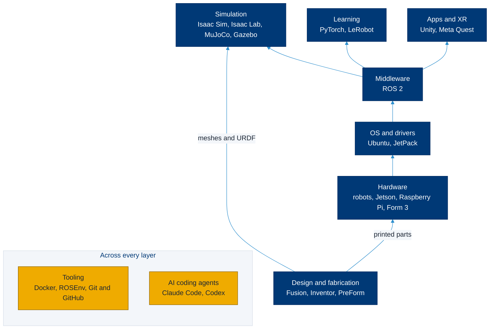

# Tech stack

> **Read this when** you want to see how the lab's software fits together, pick a tool for a project, or find the page that sets one up.

The lab's software, from the robots and their computers up to the AI coding agents we write code with. Each layer builds on the one below it; tooling and coding agents cut across all of them. Every tool below is named because lab projects use it, as a fact, not an endorsement by the lab or Kent State University. The one thing to remember: most of the stack targets **Ubuntu 24.04 LTS** today (ROS 2 Jazzy, Gazebo Harmonic and Isaac Sim 6.1 all support it), so start there unless your project says otherwise.

## The stack by layer

| Layer | Tools | Lab page | Official link |
| --- | --- | --- | --- |
| Hardware | Unitree Go2, Booster K1, OpenManipulator-X, LeRobot SO-101, Yahboom ROSMASTER X3, Jetson AGX Thor, Raspberry Pi 5, Formlabs Form 3 | [Hardware](../hardware/README.md) | Each device page links its vendor |
| OS and drivers | Ubuntu 22.04, 24.04 and 26.04 LTS; NVIDIA JetPack for Jetson | [All things ROS 2](https://github.com/ATR-Lab/all-things-ros2) (which Ubuntu for which ROS 2); [Jetson AGX Thor](../hardware/jetson-agx-thor.md) | [Ubuntu release cycle](https://ubuntu.com/about/release-cycle), [JetPack](https://developer.nvidia.com/embedded/jetpack) |
| Middleware | ROS 2 | [ROS 2](ros2.md), then [All things ROS 2](https://github.com/ATR-Lab/all-things-ros2) | [docs.ros.org](https://docs.ros.org/en/jazzy/) |
| Simulation | Isaac Sim and Isaac Lab | [Isaac Sim and Isaac Lab](isaac-sim.md) | [Isaac Sim docs](https://docs.isaacsim.omniverse.nvidia.com/latest/index.html) |
| | MuJoCo, MJX, MuJoCo Menagerie | [MuJoCo](mujoco.md) | [mujoco.org](https://mujoco.org/) |
| | Gazebo and `ros_gz` | [Gazebo](gazebo.md) | [gazebosim.org](https://gazebosim.org/) |
| Learning | PyTorch | Used through LeRobot, Isaac Lab and your own code | [pytorch.org](https://pytorch.org/get-started/locally/) |
| | Hugging Face LeRobot | [LeRobot](lerobot.md) | [LeRobot docs](https://huggingface.co/docs/lerobot) |
| Design and fabrication | Autodesk Fusion and Inventor | [Autodesk Fusion and Inventor](autodesk.md) | [Autodesk Education](https://www.autodesk.com/education/edu-software/overview) |
| | Formlabs PreForm | [From CAD to the Form 3](autodesk.md#from-cad-to-the-form-3-printer), [Formlabs Form 3](../hardware/formlabs-form-3.md) | [PreForm](https://formlabs.com/software/preform/) |
| Apps and XR | Unity 6, Meta XR SDK for Meta Quest | [Unity](unity.md) | [Unity](https://unity.com/releases/unity-6), [Meta Quest for Unity](https://developers.meta.com/horizon/documentation/unity/unity-project-setup/) |
| Tooling | Docker and the NVIDIA Container Toolkit | [Docker](docker.md) | [Docker docs](https://docs.docker.com/) |
| | ROSEnv | [ROSEnv](docker.md#rosenv-for-ros-2-projects) | [MarcoDotIO/rosenv](https://github.com/MarcoDotIO/rosenv) |
| | Git and GitHub | [Dev guidelines](https://github.com/ATR-Lab/dev-guidelines) | [git-scm.com](https://git-scm.com/), [GitHub Docs](https://docs.github.com/) |
| AI coding agents | Claude Code | [Claude Code](claude-code.md) | [Claude Code docs](https://code.claude.com/docs/en/overview) |
| | Codex | [Codex](codex.md) | [Codex docs](https://learn.chatgpt.com/docs/codex/cli) |

Students can get free developer tools, including GitHub features, through the [GitHub Student Developer Pack](https://education.github.com/pack).

## Versions at a glance

Current versions checked on Sept. 30, 2026 (each page links its source)

| Tool | Version | Notes |
| --- | --- | --- |
| Ubuntu | 24.04.5 LTS, 26.04.1 LTS | 22.04 LTS standard support ends May 2027 |
| NVIDIA JetPack | 7.2.1 (Ubuntu 24.04; Jetson AGX Thor and Orin) | 6.2.3 is the latest JetPack 6 for Orin (Ubuntu 22.04) |
| ROS 2 | Lyrical (May 2026, LTS), Kilted, Jazzy (LTS), Humble (LTS) | Details in [All things ROS 2](https://github.com/ATR-Lab/all-things-ros2) |
| Isaac Sim | 6.1.0 | ROS 2 Humble and Jazzy |
| Isaac Lab | 3.0.0 early access; 2.3.2 stable | 3.0 general availability targeted for late October 2026 |
| MuJoCo | 3.14.0 | Menagerie `mujoco-menagerie` 2026.9.0 |
| Gazebo | Jetty, Ionic, Harmonic, Fortress | Harmonic pairs with Jazzy |
| PyTorch | 2.14 | Needs Python 3.10 or later |
| LeRobot | 0.6.1 | Needs Python 3.12 or later |
| Unity | 6.3 LTS | Supported until December 2027 |
| PreForm | 3.63.1 | |
| NVIDIA Container Toolkit | 1.20.1 | |
| Claude Code, Codex | Update themselves or through your package manager | Check with `claude --version` and `codex --version` |

## Related

- [Hardware](../hardware/README.md): the robots and computers at the bottom of the stack
- [All things ROS 2](https://github.com/ATR-Lab/all-things-ros2): the lab's ROS 2 guide
- [Dev guidelines](https://github.com/ATR-Lab/dev-guidelines): code style, Git and AI-assisted development
- [Research standards](../research/standards.md): reproducibility and artifacts

Last reviewed: Sept. 30, 2026 · Sources checked on that date · [Suggest a change](https://github.com/ATR-Lab/getting-started-atr-lab/edit/master/tech-stack/README.md)
